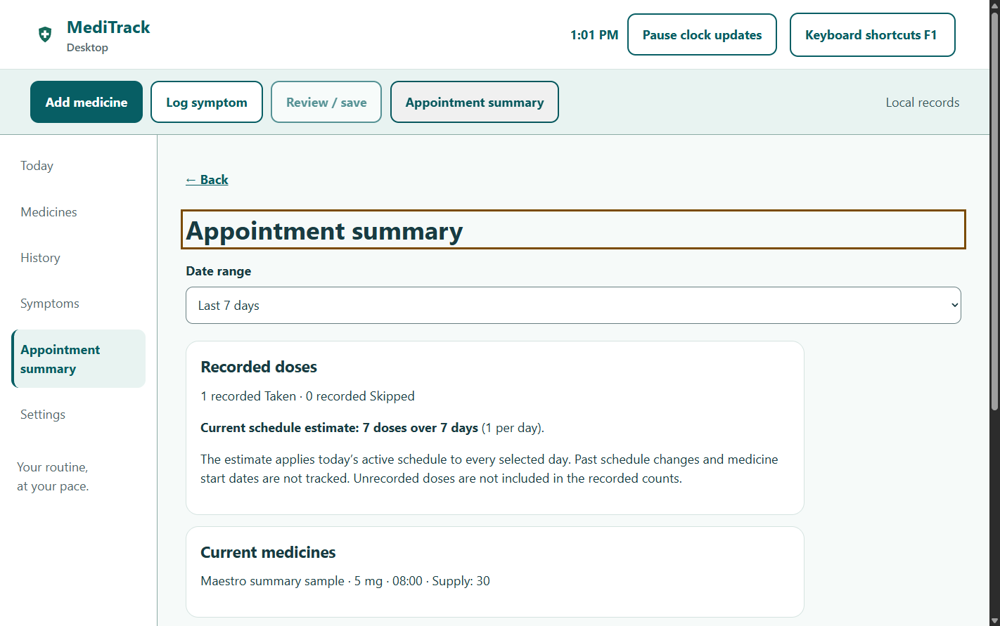
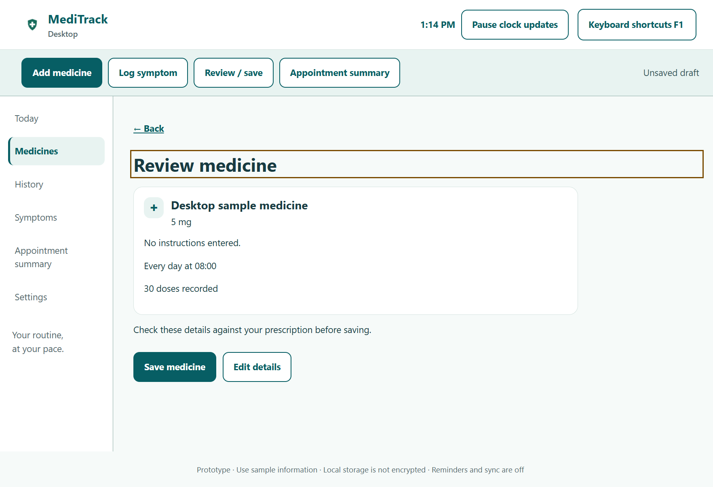

# Desktop test evidence

Captured on Windows x64 on November 6, 2026, using fictional medicine and symptom records. These are screenshots from the running desktop implementation, not the earlier HTML design preview.

## Results

| Check | Result |
| --- | --- |
| Shared React unit/component/integration tests | 53 passed |
| Shared Chromium E2E tests, phone/tablet/desktop viewports | 39 passed |
| Native menu unit tests | 2 passed |
| Native Electron E2E flows | 5 passed |
| Maestro Chromium flows | 5 passed |
| Axe scans within native flows | 8 scans, zero automated violations |
| Shared React coverage | 100% lines/statements/functions; 96.91% branches |
| Desktop/shared formatting, lint and production builds | Passed |
| Portable Windows application | Built; packaged startup and Ctrl+N smoke check passed |

Coverage describes the shared React source, not the Electron main process. Axe also reports items needing human review: the shared clock's `time` label, a decorative medicine symbol, and dialog contrast detection. Zero automated violations is not a claim of full WCAG or screen-reader conformance. Actual screen-reader speech remains untested; see the [manual acceptance procedure](../SUBMISSION.md#manual-screen-reader-acceptance-procedure--pending).

The complete command is `node desktop/run.mjs test`. The live HTML reports are generated under `desktop/reports/`, `desktop/playwright-report/`, and `react/playwright-report/`. CI uploads them as artifacts. The JSON files here are compact summaries without machine-specific paths: [Electron flows](electron-results.json), [Maestro flows](maestro-results.json), and [packaged startup](package-smoke.json).

Local Flutter verification stopped at its version check because the installed SDK was 3.47.8 and the repository requires 3.47.5. The separate Flutter GitHub workflow performs that verification with the pinned SDK.

## Maestro Chromium screenshots

Maestro 2.11.0 ran the five YAML definitions at a 1440 × 1100 browser window. Screenshots show the visible browser content; some pages are intentionally scrolled to the asserted result.

| Flow | Evidence |
| --- | --- |
| Medicine | [Required-field validation](chromium/01-validation.png) · [Review](chromium/01-review.png) · [Saved details](chromium/01-saved.png) |
| Doses | [Taken](chromium/02-taken.png) · [Corrected history](chromium/02-corrected-history.png) |
| Symptoms | [Saved symptom, severity and notes](chromium/03-symptom.png) |
| Summary | [Recorded totals](chromium/04-summary.png) · [30-day estimate](chromium/04-thirty-day-summary.png) |
| Accessibility | [Search](chromium/05-search.png) · [Shortcut dialog](chromium/05-shortcuts.png) · [200% text](chromium/05-large-text.png) |

## Native Electron screenshots

Playwright launched Electron 45.2.3 with isolated temporary profiles. Screenshots capture the Electron renderer; they exclude the operating system title bar and native menu. Menu definitions, exact accelerator bindings and callbacks have separate tests. Native close and reload confirmation are tested by supplying Keep working and Discard responses to Electron's dialog API. The reset test intercepts the renderer confirmation, checks that it names the desktop records, and cancels deletion.

| State | Evidence |
| --- | --- |
| Validation and keyboard review | [Validation focus](electron/medicine-validation.png) · [Review](electron/medicine-review.png) |
| Saved data | [Dose Taken](electron/dose-taken.png) · [Symptom](electron/saved-symptom.png) |
| Draft protection | [Leave-draft dialog](electron/draft-protection.png) · [Recovery preserves a new draft](electron/recovered-save-retains-new-draft.png) |
| Keyboard and display | [Shortcut focus](electron/keyboard-shortcuts.png) · [200% text and forced colors](electron/large-text-forced-colors.png) |
| Portable app | [Packaged app home](electron/packaged-home.png) |

